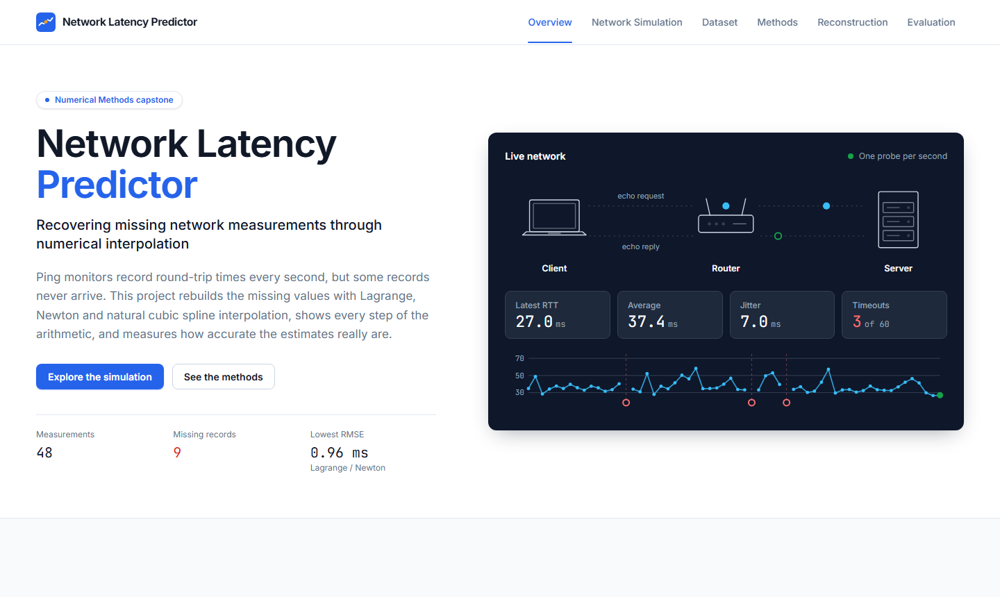
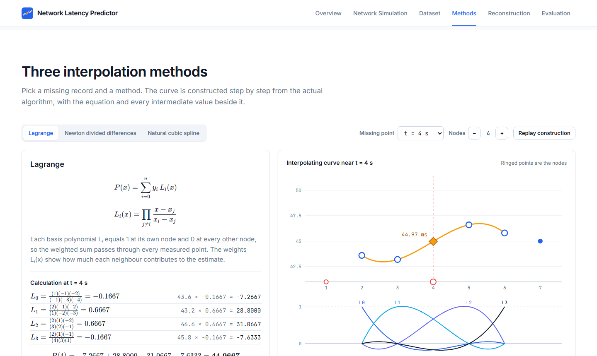

# Network Latency Predictor

**Recovering missing network measurements through numerical interpolation.**

An interactive numerical methods application for reconstructing missing network latency
measurements using Lagrange interpolation, Newton divided differences and natural cubic splines.
Built as a Numerical Methods capstone: a responsive website that opens on a live network
simulation and walks through the whole problem, from why ping records go missing to how
accurately each method recovers them. Every number on screen comes from the real algorithms.

**Live site: https://applied-maths.vercel.app**



## Features

- **Live network simulation** — client → router → server with packets in flight, live round-trip
  time, average, jitter and timeout statistics, a latency chart, and controls for pause, reset,
  speed and packet loss.
- **Missing-data explorer** — the latency series loses measurements before your eyes; toggle
  between the complete and incomplete series and see how gaps distort the statistics.
- **Dataset and validation** — seeded synthetic data or CSV upload (`timestamp,ping_ms`), a
  record-by-record table, and a preprocessing pipeline that rejects malformed rows with reasons.
- **Three interpolation methods** — Lagrange, Newton divided differences and natural cubic spline,
  each with its equation, every intermediate value and an animated construction of the curve at
  any missing point you pick.
- **Reconstruction** — every gap filled in turn, estimates shown in amber, original versus
  reconstructed comparison, and the working behind each estimate.
- **Evaluation** — artificial masking of known values, MAE, RMSE and maximum absolute error per
  method, comparison charts and the best method highlighted from the actual results.



## Getting started

Requires Node.js 20 or newer.

```bash
npm install
npm run dev                          # http://localhost:5173
npm run build && npm run preview     # production build at http://localhost:4173
```

## Testing

```bash
npm run lint        # oxlint
npm run typecheck   # tsc -b
npm test            # Vitest unit and component tests
npm run test:e2e    # production build + Playwright (first run: npx playwright install chromium)
npm run check       # all of the above

# run the end-to-end suite against the deployed site instead of a local build
BASE_URL=https://applied-maths.vercel.app npx playwright test
```

The suite covers the numerical properties of each method (exact polynomial recovery, spline
continuity and boundary conditions, Lagrange–Newton agreement), ground-truth isolation, CSV
validation, the metrics, and end-to-end behaviour of the website at four screen widths. See
[docs/TEST_REPORT.md](docs/TEST_REPORT.md) for the latest results.

## Project structure

```
src/
  algorithms/       Lagrange, Newton, natural cubic spline, node selection, validation
  simulation/       seeded generator, missing-data masks, probe model, live network engine
  data/             CSV parsing, preprocessing pipeline, dataset factories
  reconstruction/   pipeline that only ever sees the observed dataset
  evaluation/       error metrics and method comparison
  site/             navigation, hero and the page sections
  components/       charts, network diagram, dataset controls, equation rendering
  styles/           design tokens (CSS variables and tokens.ts for charts)
e2e/                Playwright tests
docs/               full project documentation
```

## Documentation

| Document | Contents |
| --- | --- |
| [PRD](docs/PRD.md) | Requirements |
| [Implementation plan](docs/IMPLEMENTATION_PLAN.md) | Phases and key decisions |
| [System architecture](docs/SYSTEM_ARCHITECTURE.md) | Website structure, data isolation, animation, design system |
| [Mathematical methodology](docs/MATHEMATICAL_METHODOLOGY.md) | Derivations and a worked example |
| [Algorithm implementation](docs/ALGORITHM_IMPLEMENTATION.md) | Code-level algorithms and tolerances |
| [Dataset documentation](docs/DATASET_DOCUMENTATION.md) | Generator, masks, preprocessing, CSV format, simulation |
| [Test report](docs/TEST_REPORT.md) | What is tested and the results |
| [User guide](docs/USER_GUIDE.md) | Running and using the site |
| [Viva questions](docs/VIVA_QUESTIONS.md) | Likely questions with answers |

## Tech stack

React 19, TypeScript, Vite, Tailwind CSS 4, GSAP with ScrollTrigger, KaTeX, PapaParse, Vitest,
Testing Library and Playwright. Typography is Inter with JetBrains Mono for numbers.

## Notes

- Network traffic is simulated with a seeded model of propagation, transmission and queuing
  delays; no real ICMP packets are sent.
- Accuracy is measured on hidden known values; it does not validate estimates of values that were
  never measured.
- Names for the footer credits can be added in `src/config/credits.ts`.
